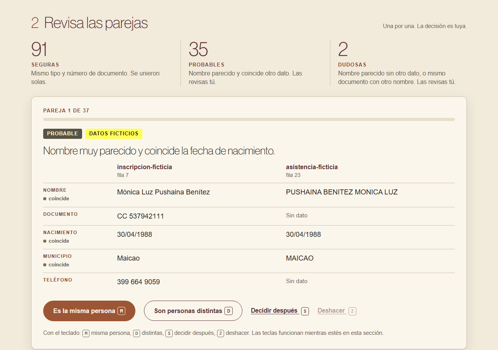

# Beneficiarios sin duplicados · Colombia

[Español](#español) · [English](#english)

## Español

Una herramienta gratis y abierta que junta varias listas de beneficiarios (inscripción, asistencia, entregas), encuentra a la misma persona aunque esté escrita distinto y te deja decidir los casos dudosos uno por uno. Es para equipos de cooperación, ONG, fundaciones, universidades y proyectos que tienen que informar personas únicas a un financiador.

**Ábrela aquí:** https://estado-x.github.io/beneficiarios-unicos-colombia/

### Qué hace

- Carga una o varias listas en Excel (`.xlsx`) o CSV, arrastrándolas o eligiéndolas.
- Adivina por el encabezado qué es cada columna (nombres, apellidos o nombre completo, tipo y número de documento, fecha de nacimiento, municipio, teléfono) y te deja corregirlo a mano.
- Empareja las filas en tres niveles:
  - **Seguras:** mismo tipo y número de documento. Se unen solas, y las puedes ver.
  - **Probables:** nombre parecido y coincide otro dato (fecha de nacimiento, teléfono, municipio o un documento que difiere en un dígito).
  - **Dudosas:** nombre parecido sin otro dato, o mismo documento con nombres muy distintos (puede ser un error de digitación).
- Te muestra las probables y las dudosas una por una, con los datos lado a lado, para que digas «Es la misma persona» o «Son personas distintas», con el ratón o con el teclado (`M`, `D`, `S` para decidir después, `Z` para deshacer).
- Dice cuántas filas había, cuántas personas únicas quedan y cuántas decisiones tomaste, y descarga un Excel con cuatro hojas: personas únicas (una fila por persona, con su ID único y de qué listas viene), todas las filas originales con su ID, las decisiones tomadas y un resumen.
- Todo pasa en tu navegador: las listas no se envían a ningún servidor y no se guardan al cerrar.

Trae un botón **Probar con el ejemplo** con tres listas de datos ficticios (`ejemplos/`).

### Cómo funciona

1. **Lee** los archivos en el navegador. El `.xlsx` es un `.zip` con XML: se abre con `assets/zip.js` y `assets/leer.js`, sin librerías de terceros. El CSV se lee con su codificación (UTF-8 o la de Windows) y su separador (coma, punto y coma, tabulador o barra).
2. **Normaliza** (`assets/nombres.js`): mayúsculas, tildes y eñes, espacios dobles, partículas («de», «del», «de la»), iniciales («Pérez C.»), puntos y espacios en la cédula, lo que deja Excel cuando guarda un documento como número, fechas en varios formatos (dd/mm/aaaa, aaaa-mm-dd, «7 de marzo de 1990», número de serie de Excel), municipios («Bogotá, D.C.») y teléfonos. Lo que ves en pantalla y en el Excel conserva la ñ y las tildes como venían.
3. **Compara nombres por palabras**, sin importar el orden: «PÉREZ CUERVO JUAN CAMILO» y «Juan Camilo Pérez C.» son el mismo nombre. Dos palabras casan si son iguales, si suenan igual (González/Gonzales, Jhon/John, Jiménez/Giménez), si tienen un error de digitación (distancia de edición) o si una es la inicial de la otra. No cuenta como error lo que cambia el nombre: Mario/María, Juan/Juana.
4. **Usa bloques** para no comparar todos contra todos (`assets/emparejar.js`): cada fila solo se compara con las que comparten el documento, el teléfono, dos palabras del nombre, o la fecha de nacimiento y una palabra. La comparación corre en un Web Worker, así la página no se traba: 20.000 filas toman unos segundos.
5. **Arma los grupos**: lo seguro se une solo; lo demás, solo si tú lo dices. Lo que no decidas queda como personas distintas, con la marca «Sin decidir».
6. **Escribe el Excel** en el navegador (`assets/excel.js`). El texto va siempre como texto: una celda que empiece por `=`, `+`, `-` o `@` no queda como fórmula.

No hay servidor, base de datos, claves ni rastreadores. La página trae una política de seguridad de contenido que solo le permite pedir archivos de su propia carpeta.

### Úsala o adáptala

- **Úsala** en la dirección de arriba, o descarga este repo (rama `main`) y sírvelo desde tu computador: `python -m http.server` en la carpeta y abre `http://localhost:8000`. Abrir `index.html` con doble clic también sirve para cargar tus listas; el botón del ejemplo necesita el servidor.
- **Adáptala:** los umbrales del parecido y las reglas de cada nivel están al comienzo de `assets/emparejar.js`; las formas de escribir tipos de documento, municipios y partículas, en `assets/nombres.js`; las palabras con las que se reconoce cada columna, en `assets/leer.js`.
- **Pruebas:** `node pruebas/funciones.test.js` (normalización y parecido, sin instalar nada) y `python pruebas/probar.py` (la página en Chromium con Playwright: carga, ejemplo, teclado, 390 px, fórmulas, archivos dañados, 20.000 filas y el Excel descargado). `python pruebas/generar_ejemplos.py` vuelve a crear los datos ficticios.

### Límites

- No consulta la Registraduría ni ninguna base oficial, y no confirma identidades. Compara lo que está escrito en tus listas.
- No decide por ti en los casos dudosos y no reemplaza la verificación en campo.
- Si un documento quedó mal digitado igual en todas las listas, no se nota. Si dos personas distintas comparten nombre y no hay otro dato, te las muestra como dudosas: decides tú.
- Dos filas con documentos distintos del mismo tipo se toman como personas distintas, salvo que difieran en un solo dígito o que coincidan el nombre completo y la fecha de nacimiento.
- La primera fila con datos de cada lista debe traer los nombres de las columnas. No lee `.xls` (el formato antiguo), `.ods` ni Excel con clave: guárdalos como `.xlsx` o CSV.
- Está probada con 20.000 filas en Chromium. Con listas mucho más grandes depende de la memoria del computador.
- La Ley 1581 de 2012 protege los datos personales: quien maneja listas de beneficiarios es responsable de su tratamiento, también del Excel que descarga.

### Crédito

- Inspirada en [Splink](https://github.com/moj-analytical-services/splink), del Ministerio de Justicia del Reino Unido (licencia MIT): de ahí viene la idea de vincular registros por bloques y niveles de coincidencia. Se escribió desde cero para el navegador; no reutiliza su código.
- `assets/zip.js` y `assets/excel.js` vienen de [facturas-colombia](https://github.com/Estado-X/facturas-colombia), de Estado X (licencia MIT), adaptados.
- Los datos de `ejemplos/` son ficticios: nombres armados al azar y documentos inventados.

### Hecho por Estado X

Licencia MIT. Esta herramienta es una muestra de lo que montamos en Consultorio X de Estado X para el registro de beneficiarios y los informes a financiadores. Para hablar de tu caso, escríbele a Juan Camilo Pérez Cuervo en LinkedIn: https://www.linkedin.com/in/juanperezcuervo/

## English

A free, open tool that merges several beneficiary lists (registration, attendance, deliveries), finds the same person even when the name is written differently, and lets you decide the doubtful cases one by one. Built for cooperation teams, NGOs, foundations, universities and projects that must report unique people to a funder. Everything runs in your browser: your lists are never uploaded.

**Open it here:** https://estado-x.github.io/beneficiarios-unicos-colombia/

- **What it does:** loads Excel (`.xlsx`) or CSV lists, guesses each column from its header (you can fix it by hand), and matches rows at three levels: *sure* (same ID type and number, merged automatically), *probable* (similar name plus another matching field) and *doubtful* (similar name with nothing else, or same ID with very different names). You review probable and doubtful pairs side by side, with mouse or keyboard, and download an Excel file with unique people (one row each, with a unique ID and source lists), every original row with its ID, the decisions made and a summary.
- **How it works:** plain JavaScript, no third-party libraries. Names are normalized for Colombian conventions (two surnames, surnames first or last, particles, initials, lost accents and ñ) and compared word by word regardless of order, using exact, sound-alike, edit-distance and initial matches. Blocking (same ID, phone, two name words, or birth date plus one word) avoids comparing every row with every other; the comparison runs in a Web Worker, so 20,000 rows take a few seconds. Text cells starting with `=`, `+`, `-` or `@` are never written as formulas.
- **Use or adapt it:** use the page above, or download the repo (`main` branch) and serve it locally with `python -m http.server`. Thresholds and level rules live at the top of `assets/emparejar.js`. Tests: `node pruebas/funciones.test.js` and `python pruebas/probar.py` (Playwright).
- **Limits:** it does not query any official registry or confirm identities, does not decide doubtful cases for you and does not replace field verification. It only compares what is written in your lists. It does not read legacy `.xls` or password-protected files. Personal data is protected by Colombian Law 1581 of 2012; whoever handles beneficiary lists is responsible for them.
- **Credit:** inspired by [Splink](https://github.com/moj-analytical-services/splink), by the UK Ministry of Justice (MIT license); written from scratch for the browser, it doesn't reuse its code. The data in `ejemplos/` is fictitious.

Made by Estado X · MIT license.
